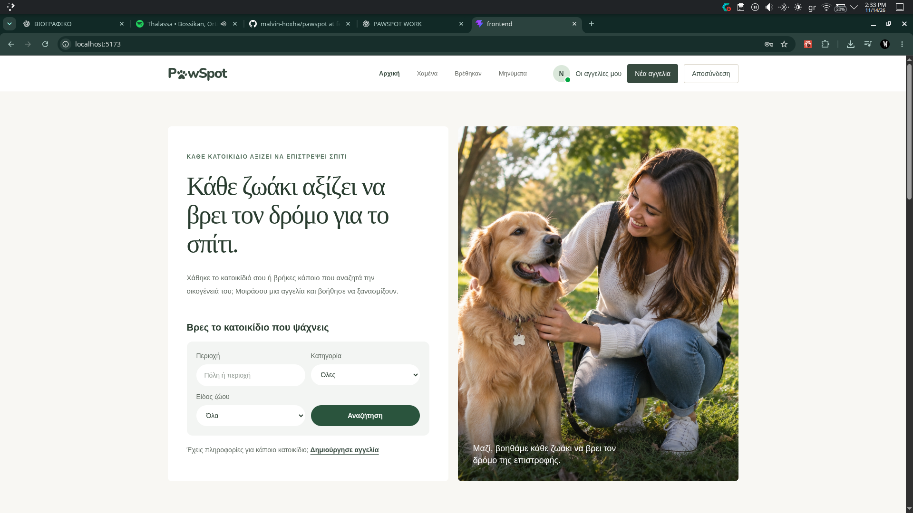
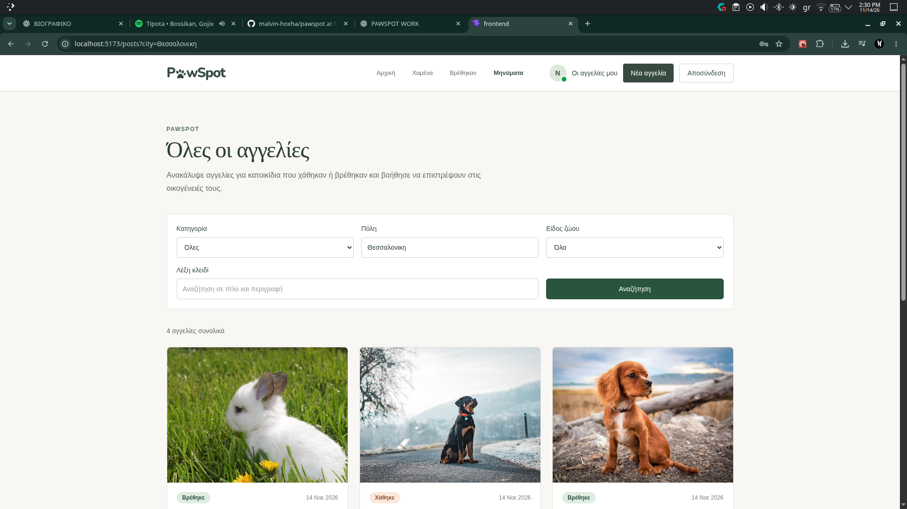
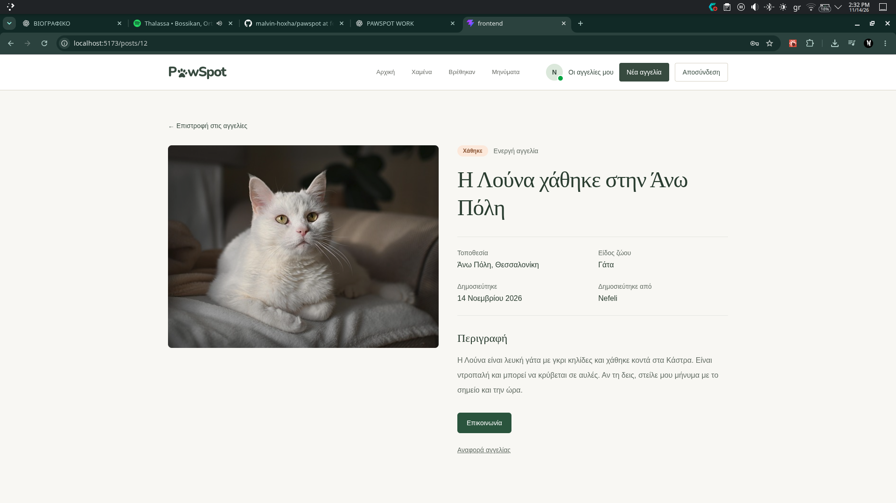
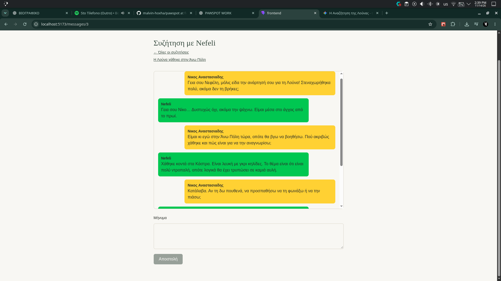
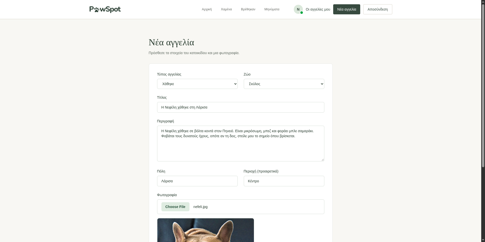

# PawSpot

PawSpot is a full-stack lost-and-found pet platform. Visitors can browse public listings, open listing details, and search by category, location, species, or keyword. Signed-in users can publish and manage photo listings, contact another listing's owner through private conversations, submit reports on listings for future review, and manage their account. The interface is primarily in Greek.

**Main technologies:** Java 17, Spring Boot, Spring Security, PostgreSQL, React, TypeScript, Vite, Tailwind CSS, TanStack Query, and Cloudinary.



## More screenshots

<table>
  <tr>
    <td width="25%"></td>
    <td width="25%"></td>
    <td width="25%"></td>
    <td width="25%"></td>
  </tr>
  <tr>
    <td align="center">Public listings</td>
    <td align="center">Listing details</td>
    <td align="center">Private conversation</td>
    <td align="center">Create listing and photo preview</td>
  </tr>
</table>

## Features

- **Public lost-and-found listings:** Anyone can browse paginated listings and view their photos, location, species, status, description, and author.
- **Search and filters:** The listings screen supports lost/found category, species, partial city matching, and keyword search across titles and descriptions. Filters and pagination are stored in the URL; the API also supports status, sorting, and page-size parameters.
- **Photo listing management:** Signed-in users can create a listing with a validated image and preview, edit its details or status, and delete it. Images are stored in Cloudinary.
- **Accounts:** Visitors can register and sign in through the UI. Users can delete their account after password confirmation; their listings and refresh-session data are removed as part of that flow.
- **Private messaging:** An interested user can open one private conversation per listing, both participants can exchange messages, and older messages are loaded when the conversation history is scrolled upward.
- **Post reports:** Signed-in users can select a reason, add an optional description, and submit a listing report. Reports are stored as pending for future review; admin review and moderation are not implemented yet.
- **Cookie-based authentication:** JWT access and refresh tokens use HTTP-only cookies, with BCrypt password hashing and CSRF protection for state-changing requests.

## Tech stack

| Area | Technologies |
| --- | --- |
| Backend | Java 17, Spring Boot, Spring Security, Spring Data JPA, Jakarta Validation |
| Database | PostgreSQL 17, PostgreSQL `unaccent` extension |
| Frontend | React, TypeScript, Vite, Tailwind CSS, React Router |
| API and server state | Axios, TanStack Query |
| Mapping and image storage | MapStruct, Cloudinary |
| Backend testing | JUnit, Mockito, Spring Boot Test, Testcontainers |
| Frontend testing | Vitest, React Testing Library, MSW, Playwright |
| Local tooling | Maven Wrapper, npm, Docker Compose |

## Implementation highlights

- **Refresh-token rotation and reuse detection:** [Rotation runs transactionally](backend/src/main/java/com/pawspot/auth/refreshtoken/service/RotationTransactionService.java), locking the user and refresh-session rows. Reuse of a revoked token revokes its session and token family.
- **Authorization at the service layer:** [Post mutations verify ownership](backend/src/main/java/com/pawspot/post/PetPostService.java), while [conversation reads and writes verify participation](backend/src/main/java/com/pawspot/message/service/ConversationService.java) without exposing whether another user's conversation exists.
- **Duplicate-conversation prevention:** Conversation creation locks the listing before checking for an existing participant/listing pair, and a [database unique constraint](backend/src/main/java/com/pawspot/message/Conversation.java) provides a second guard against duplicates.
- **Composable database filters:** [JPA Specifications](backend/src/main/java/com/pawspot/post/specification/PetPostSpecification.java) combine optional filters and use PostgreSQL `unaccent` for city matching. Pagination adds an ID tie-breaker for stable ordering.
- **Coordinated browser authentication:** The [API client](frontend/src/api/client.ts) retries an eligible request once after refresh with identity checks, while [Web Locks](frontend/src/api/authLock.ts) serialize authentication operations across tabs.
- **Database and image consistency:** If saving a new listing fails after upload, the service attempts to remove the Cloudinary image. Listing deletion commits the database operation before attempting external image cleanup.

## Run locally

### Prerequisites

- JDK 17 or newer.
- Node.js 24.15 or newer within the Node.js 24 release line, with npm.
- Docker with Docker Compose, with the Docker daemon running.
- A Cloudinary account for uploading images.
- Bash or a compatible shell for the commands below; OpenSSL for generating a signing key.

### 1. Clone and configure

```bash
git clone https://github.com/malvin-hoxha/pawspot.git
cd pawspot
cp .env.example .env
```

Fill in `.env` with local values. Add the Cloudinary variables, which are not included in the current example file:

```dotenv
POSTGRES_DB=pawspot
POSTGRES_USER=pawspot
POSTGRES_PASSWORD=replace-with-a-local-password
JWT_SECRET=replace-with-a-base64-signing-key
CLOUDINARY_CLOUD_NAME=your-cloud-name
CLOUDINARY_API_KEY=your-api-key
CLOUDINARY_API_SECRET=your-api-secret
FRONTEND_ORIGIN=http://localhost:5173
```

Generate a signing key and copy its output into `JWT_SECRET`:

```bash
openssl rand -base64 32
```

Use shell-compatible values in `.env`, quoting values that contain spaces or shell metacharacters. The file is ignored by Git.

### 2. Start PostgreSQL

From the repository root:

```bash
docker compose up -d postgres
docker compose exec postgres pg_isready
```

Once PostgreSQL is ready, enable the extension used for city searches:

```bash
docker compose exec -T postgres sh -c 'psql -U "$POSTGRES_USER" -d "$POSTGRES_DB" -c "CREATE EXTENSION IF NOT EXISTS unaccent;"'
```

Docker Compose runs PostgreSQL only. The backend and frontend run separately. Database data is retained in a named Docker volume.

### 3. Start the backend

In a terminal at the repository root:

```bash
set -a
source .env
set +a
cd backend
./mvnw spring-boot:run
```

Exporting the variables is necessary: Spring Boot does not automatically load the root `.env` file. The backend listens at `http://localhost:8080` and creates or updates its local schema through Hibernate.

### 4. Start the frontend

In another terminal at the repository root:

```bash
cd frontend
npm ci
npm run dev -- --port 5173 --strictPort
```

Open **http://localhost:5173**. Vite proxies `/api` requests to the backend on port 8080. Keep port 5173 for the documented CORS and Playwright configuration.

### 5. Create a local account

With both servers running, open **http://localhost:5173/register** and create an account, then sign in at `/login`. A fresh database starts without listings; creating one requires valid Cloudinary credentials.

The default cookie settings are intended for local HTTP development. An HTTPS deployment requires secure cookies and deployment-specific configuration.

## Tests

### Backend

From `backend/`:

```bash
./mvnw test
```

Integration tests use a separate PostgreSQL 17 Testcontainer and test-only configuration. Docker must be running. Coverage includes post authorization and validation, refresh-token rotation and reuse, account deletion, messaging and duplicate-conversation prevention, report submission, and concurrent database operations.

### Frontend unit and integration tests

From `frontend/`, after `npm ci`:

```bash
npm run test:run
```

These tests cover API-client behavior and authentication hooks, including delayed requests and login/logout races.

### Browser tests

Keep the backend and Vite development server running. Use the registration page to create two distinct local test accounts, then run the following from `frontend/`:

```bash
npx playwright install chromium
export E2E_USER_A_EMAIL='first-test-user@example.com'
export E2E_USER_A_PASSWORD='replace-with-first-test-password'
export E2E_USER_B_EMAIL='second-test-user@example.com'
export E2E_USER_B_PASSWORD='replace-with-second-test-password'
npx playwright test
```

Use the actual credentials of the two accounts you created. Playwright does not start the application servers or register these users automatically. The suite exercises concurrent refresh, cross-tab logout, expired sessions, and retries after an identity change.

## API overview

| Method | Endpoint | Purpose / access |
| --- | --- | --- |
| `GET` | `/api/auth/csrf` | Initialize CSRF protection |
| `POST` | `/api/auth/register` | Create an account |
| `POST` | `/api/auth/login` | Authenticate and set token cookies |
| `POST` | `/api/auth/refresh` | Rotate a valid refresh token |
| `POST` | `/api/auth/logout` | Revoke the refresh session and clear cookies |
| `GET` | `/api/auth/me` | Get the authenticated user |
| `GET` | `/api/posts` | Public, filtered, sorted, and paginated listings |
| `GET` | `/api/posts/{id}` | Public listing details |
| `POST` | `/api/posts` | Authenticated; multipart listing fields and `image` |
| `GET` | `/api/posts/my` | Authenticated user's listings |
| `PATCH` | `/api/posts/{id}` | Owner only; partial JSON update |
| `DELETE` | `/api/posts/{id}` | Owner only |
| `POST` | `/api/posts/{postId}/conversations` | Authenticated non-owner; open or return the existing conversation |
| `GET` | `/api/conversations` | Participant's paginated conversation inbox |
| `GET` | `/api/conversations/{conversationId}` | Participant only; conversation details |
| `GET` | `/api/conversations/{conversationId}/messages` | Participant only; paginated message history |
| `POST` | `/api/conversations/{conversationId}/messages` | Participant only; send a message |
| `POST` | `/api/posts/{postId}/reports` | Authenticated; submit a report for review |
| `DELETE` | `/api/users/me` | Authenticated; password confirmation in JSON |

State-changing requests require a valid CSRF token, including registration and login. Browser requests use cookies and the `X-XSRF-TOKEN` header.

Listing query parameters: `type`, `status`, `species`, `city`, `search`, `page`, `size`, `sortBy`, and `direction`. Pagination is zero-based; page size defaults to 10 and is limited to 100.

## Project structure

| Path | Contents |
| --- | --- |
| `backend/src/main/java/com/pawspot/auth/` | Authentication and refresh-token lifecycle |
| `backend/src/main/java/com/pawspot/post/` | Listings, filters, ownership checks, and persistence |
| `backend/src/main/java/com/pawspot/message/` | Private conversations, messages, and participant checks |
| `backend/src/main/java/com/pawspot/report/` | Report submission and pending report records |
| `backend/src/main/java/com/pawspot/user/` | Account data and deletion flow |
| `backend/src/test/` | Unit and PostgreSQL integration tests |
| `frontend/src/api/` | HTTP client plus auth, listing, messaging, and reporting requests |
| `frontend/src/features/auth/` | Authentication functions, hooks, and route protection |
| `frontend/src/pages/` | Public browsing and authenticated account, listing, and messaging screens |
| `frontend/src/components/posts/` | Listing cards, filters, and report form |
| `frontend/tests/` | API-client, authentication, and browser tests |
| `docker-compose.yml` | Local PostgreSQL service |

## Next steps

- Build an admin report queue with review decisions and listing moderation tools.
